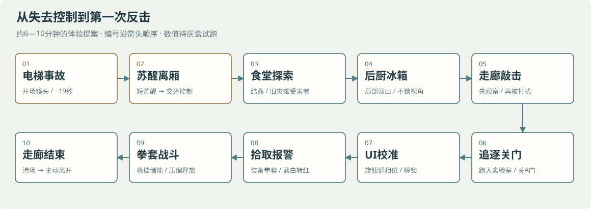

# 零界首个 Demo 流程与实现方案

**版本：V0.1　日期：2026年10月29日　交付阶段：设计与制作方案**

本 Demo 从电梯下降开始，到主角离开苏联冲量储存实验室后的短走廊结束。建议初次体验约 **6—10 分钟**，把“事故受困—认识结晶异常—被迫逃跑—取得拳套—首次反击”做成一个完整段落。时长与数值均为灰盒起点，尚无实机验证。

本次仅新增设计文件，未修改 Unity 场景、游戏脚本或项目包。世界观参考用户提供的《GPT版世界观文档.docx》；本文把用户这次描述作为 Demo 流程的最新约束。参考文档中的“定稿、暂定、留白”继续保持各自状态。下文的尺寸、时序、组件名、敌人数和交互细节均为制作提案。

## 1 体验目标与流程边界

这一段最重要的变化是：玩家先发现共鸣者有自己的行为与欲求，再亲身经历“手无寸铁时只能逃，拿到实验兵装后可以反击”。走廊里的敲击场景承担世界观表达，实验室战斗承担玩法验证。

| 用户已明确的流程 | 本次补充的工作提案 |
| --- | --- |
| 原定电梯从 -2 前往 -17，在约 -8 或 -9 出事 | 暂选 -8，目的地显示与当前楼层分开 |
| 灯闪两次后熄灭，两次震动相隔约半秒到一秒 | 使用 0.75 秒间隔，片段总长约 26 秒 |
| 切竖井，承载钢缆迸火断裂，轿厢坠落并擦墙 | 用预设镜头、动画与少量粒子完成 |
| 主角离地、撞顶、摔落并昏迷 | 调整镜头中的受力衔接；严格版与夸张版待选择 |
| 醒来仍在砸入苏联食堂的电梯内，上方有破洞 | 用穿过食堂顶板的坠落路径统一空间关系 |
| 食堂有零号灾难受害者和阿比森纳斯结晶 | 用少量集中陈列的尸体讲清，保持尸体与活体区分 |
| 后厨冰箱门打开，活共鸣者掉出来，玩家保留控制 | 做无伤害的局部事件，身体落在通路侧面 |
| 共鸣者敲击严重晶化个体，被打扰后追主角 | 接近或通过区域触发警觉，不强制转镜头 |
| 追至实验室，玩家关门后追击停止 | 关门交互留容错，并明确结束这名追逐者的追击 |
| 解小谜题，拿拳套，警报与红灯，另一侧进敌人 | 单旋钮相位校准 UI；解谜、拾取、警报分别记状态 |
| 用拳套击败敌人，走出一段后 Demo 结束 | 3 名普通共鸣者分两批进入；战斗出口单独控制 |

**范围：**本次使用普通共鸣者一套基础资产。冰箱活体、敲击者与实验室敌人是不同遭遇用途；严重晶化个体优先采用固定姿态模型。它们不要求新增高级战斗怪物。牵引、碰撞回声、无人机、巨构与后续实验室留在整体项目中。

## 2 总流程与节奏

*编号按箭头顺序阅读。冰箱和敲击为场景内演出；玩家持续保留视角与移动控制。*

| 段落 | 初次体验建议 | 玩家可做什么 | 段落应传达的内容 |
| --- | --- | --- | --- |
| 电梯事故 | 约 26 秒 | 观看开场；可提供跳过 | 正常下行被第二次冲击打断 |
| 醒来与离开电梯 | 15—30 秒，含短醒来演出 | 恢复观察与移动，走出变形门口 | 轿厢砸进了旧设施 |
| 食堂探索 | 1—2 分钟 | 看尸体、结晶、旧工作环境 | 这是一场发生在过去的人员灾难 |
| 后厨局部事件 | 20—40 秒 | 保持移动与视角控制 | 结晶人员中仍有活体 |
| 敲击行为与追逐 | 观察 10—20 秒，追逐约 8—15 秒 | 看、接近、奔跑、进实验室关门 | 共振有吸引力；打断它会引来攻击 |
| 安全停顿与 UI 解谜 | 30—60 秒 | 观察实验设备，操作校准面板 | 这是冲量研究区；拳套具有设备来源 |
| 拳套与第一场战斗 | 1.5—3 分钟 | 格挡、储能、机械压缩与释放 | 把外部撞击转成自己的反击 |
| 离开实验室 | 10—20 秒 | 前行约一小段，抵达结束触发区 | 当前危险解除，旅程仍将继续 |

探索时长随玩家选择变化，不用强制等待把流程凑长。先测试追逐是否清楚、拳套是否好用，再确定最终游玩时长。

## 3 电梯开场分镜

### 3.1 楼层显示与镜头意图

当前楼层由 -2 逐步变到 -8，面板上另有一个较小的目的地“-17”。出事后当前楼层闪烁、停住或报错，**不继续伪装成已正常抵达 -17**。现代楼层编号不直接定义苏联食堂所在深度；醒来后只知道已经偏离预定路线。

建议保留“第一人称—短竖井镜头—第一人称”三个镜头段。竖井镜头约 3 秒，主要交代断裂与失控，避免长时间离开主角。

### 3.2 开场时序表

下表是第一次灰盒的剪辑提案，0 秒从电梯内开始。震动强度使用相对等级，不是已经调好的相机参数。

| 时间 | 画面与动作 | 声音与灯光 | 控制及信号 |
| --- | --- | --- | --- |
| 0.00—1.50 | 主角站在现代电梯内，看得到面板和扶手 | 平稳运行、低音量设备声 | 暂停移动与攻击；交给开场镜头 |
| 1.50—8.00 | 当前楼层依次 -2、-3、-4、-5、-6、-7、-8 | 楼层切换提示保持克制 | 面板由独立显示组件更新 |
| 8.00—8.60 | 顶灯闪两次，然后熄灭 | 两次短电流声，正常灯光完全关闭 | 环境仍留极弱面板光，维持可读轮廓 |
| 9.00 | 第一次震动，小幅短促 | 远处低沉冲击，经结构传来 | Shake A；不靠持续大幅晃动 |
| 9.75 | 第二次震动，更强且有方向 | 结构异响；与第一次相隔 0.75 秒 | Shake B；面板冻结或错误 |
| 10.00—10.70 | 硬切竖井；承载束火花、绷紧后断裂 | 金属撕裂，短电弧声 | 预设断裂模型切换 |
| 10.70—13.50 | 轿厢失控下坠，少数接触点擦墙 | 接触处火花与刮擦，导轨局部损毁 | 轿厢运动用动画路径 |
| 13.50—15.30 | 切回主角；身体短暂离地，轿厢侧倾，顶棚进入碰撞范围 | 耳鸣、呼吸、近处撞击声 | 主角演出模型与相机节点动画 |
| 15.30—17.00 | 底部撞击或急减速，主角摔向地板 | 一次重落地声、设备坍落声 | 最后冲击，迅速淡黑 |
| 17.00—19.00 | 完全黑屏 | 耳鸣渐弱，尘土碎落与呼吸接入 | 黑屏中关闭演出轿厢，激活静态事故现场 |
| 19.00—26.00 | 地面视角苏醒，逐渐撑起身体；门口可见旧设施 | 食堂的安静与偶发机械声 | 醒来完成后，把控制交还玩家 |

灯闪应短、明确，整段不要叠加强烈全屏闪白。支持减弱镜头震动；镜头的高度变化主要服务动作，不叠加无目的的大幅旋转。

### 3.3 失重段的受力衔接

自由落体中，人和轿厢可以一起下落；失重本身不会自动产生“向上加速撞顶”。NASA 对抛物线飞行的说明也强调，机舱与舱内物体共同以近似相同的重力加速度下落。[参考 NASA](https://www.nasa.gov/mission/parabolic-flight/)

**建议的严格版本：**断裂前的踉跄或本能支撑留下一个短暂的相对运动，身体离开地板；随后轿厢倾斜与碰撞，使顶棚接近主角。最终由撞击、急减速和轿厢姿态变化衔接摔回地板。用相机、手臂和一件漂起的小物件表现短暂失重，无需把角色直线上抛数米。

**保留明显“上飞”的版本：**把它作为第二次异常冲击或机械碰撞给人的额外作用来表现。它是新增的戏剧性提案，需要你选择，不能仅解释成普通失重。

灰盒先验证镜头可读性，两种版本都能用预设动画实现。制作前只需锁定一种，避免同时为两套完整演出制作资源。

### 3.4 安全机构、枪械与队友连续性

- **电梯失控：**镜头可同时给出导轨扭曲或制动部件损毁，表达多处系统受到第二次冲击破坏。它是虚构事故演出，不需要模拟真实电梯工程。
- **枪械：**参考设定要求主角失枪。若开场可见武器，增加一个短暂脱手、落出破口的动作；醒来后确认装备槽为空。不要让玩家看到枪仍在脚边却无法拾取。
- **同梯队友：**完整设定提到随队下行，新流程尚未明确有几人在这一轿厢。建议 Demo 先只拍主角，其他人通过电台或其他轿厢行动交代，具体由你决定。若坚持同梯，必须设计队友坠落后的去向，不能在切黑后凭空消失。
- **苏醒动机：**短期目标可用一次失败的电台呼叫、呼吸和走向出口表达；无需马上讲述历史或安排长篇旁白。

## 4 空间结构与食堂叙事

### 4.1 灰盒空间提案

| 区域 | 灰盒起点尺寸 | 主要路径与功能 |
| --- | --- | --- |
| 静态事故轿厢 | 内部约 2.5 × 2.5 米 | 变形门口连接食堂，出口净高支持站立或短暂低姿态 |
| 食堂 | 约 18 × 14 米 | 事故现场 → 受害者陈列 → 后厨入口 |
| 后厨 | 约 10 × 6 米 | 工作台形成轻微绕行，冰箱在可听见也可绕过的位置 |
| 敲击区域及追逐走廊 | 敲击区一个小节点，追逐有效路径约 30—45 米 | 从静观到惊觉，出口方向可预先识别 |
| 冲量储存实验室 | 约 16 × 12 米 | 关门安全区、校准终端、拳套、战斗活动区 |
| 结束走廊 | 约 8—12 米 | 清楚的离开动作，随后结束 |

所有尺寸只用于灰盒试跑。实际路径长度和转角应按角色移速测量，先确认门、相机与敌人能通过，再做美术。

### 4.2 电梯为何位于食堂

建议统一为一条明确的坠落路径：现代电梯井末端或受损底部结构之下，恰好是苏联食堂的顶板。轿厢穿破顶板，落入食堂地面；轿厢顶上方与食堂天花的大洞共同指向上方井道。无需把整个现代竖井建到食堂地面。

空间至少有三处相互对应的证据：

1. 抬头能看到破损顶板、钢筋和残余井道方向。
2. 轿厢周围有向外散落的混凝土、扭曲金属和压倒的桌椅。
3. 主角从歪斜但已经敞开的门口出去，回看时仍能理解电梯与洞的位置。

黑屏中切换到静态事故现场。洞、轿厢和碎石用预制资产摆好，不做实际穿楼板或全场景刚体破坏。醒来时保留漂尘、残余电火花和小碎块声，就能连接前后镜头。

### 4.3 苏醒到交还控制

苏醒演出只负责睁眼、恢复观察、撑起身体。建议在仍位于轿厢内时交还控制，由玩家自己穿过开门。门口不设置难按的精密攀爬输入。

若暂时没有蹲伏系统，先用一次自动低头的短相机过渡模拟“爬出”，不要为了这一个洞口新增整套身体攀爬。出口处应明确落脚点，并避免角色胶囊卡住变形门框。

### 4.4 三组环境叙事即可

- **正常用餐被打断：**餐盘、座位和个人物品仍在原位，受害者姿态与用餐活动有关。
- **人员结晶：**大部分关键尸体带阿比森纳斯晶体；局部生长比满屋水晶更能让玩家读到“这是人遭遇了变化”。
- **旧设施身份：**模拟设备、旧工装、工业配色与少量西里尔字母标识共同说明时代；不靠一整面可阅读长文。

本段尸体被用户明确设为零号灾难受害者，保持死亡状态。后续活体来自它们各自的安排，不把报警当作食堂尸体复活的开关。

目标是让玩家很快理解食堂及出口，然后自行决定是否多看一会儿。用灯光、门洞和工作台导向后厨，避免用一连串锁门拖慢探索。

## 5 后厨冰箱事件

### 5.1 玩家实际看到什么

接近后先听见冰箱内的碰撞或轻微摩擦，门扣松脱，门缓慢打开或被内部重量顶开。一个仍活着的共鸣者失去支撑，从内部滑落在地，随后有明显呼吸、手部抽动或低声呻吟。

门为什么打开可以由失效门扣与身体重量解释，不必额外引入隔空开门能力。冰箱优先用能容纳人形的立式工业冷藏柜。它是否仍通电、为何有人存续至今都保持留白，场景不必添加新鲜冷气或完整冷冻复苏解释。

### 5.2 触发及控制规则

| 条目 | 建议规则 |
| --- | --- |
| 首次触发 | 玩家进入后厨观察区，事件尚未播放 |
| 视角 | 不切相机、不锁移动、不主动把镜头转向冰箱 |
| 漏看处理 | 先用声音引导；有视线时播放最佳画面。玩家一直不看也允许继续，事件在区域内延迟一次后自行完成 |
| 阻挡 | 柜门和倒下身体落在主通路侧边；通路持续可走 |
| 威胁 | 第一版不主动攻击，保留“活着”的反馈 |
| 动画 | 门与人形用局部 Animator 或独立 PlayableDirector；不用刚体布娃娃随机决定落点 |
| 重复进入 | 一次性事件完成后不重播；倒地状态保留 |
| 死亡重试 | 由对应检查点重置局部状态，不依赖 Collider 永久禁用充当保存系统 |

这是一个物件与角色的**场景内演出**。局部 Timeline 仅绑定冰箱门、身体、音源和特效，没有相机轨道，也不申请玩家输入锁。

### 5.3 资源复用

复用普通共鸣者身体，增加滑落和倒地喘息两种姿态。这个个体不参与实验室战斗计数。初版不要求它起身寻路，也不为它单独做敌人品种。

## 6 敲击行为与追逐

### 6.1 把成瘾表现出来

玩家从后厨出口先听到断续而有规律的敲击。进入可观察位置后，看到症状较轻的共鸣者伏在严重晶化个体旁或身上，反复敲击突出晶体。每次敲击带出一声清晰的共振，它短暂停下、贴近、颤抖，再继续敲击。

严重晶化对象保持近乎静止的固定姿态；它是同一异常的严重状态，不自动定义为高级战斗共鸣者。是否保留微弱呼吸可以后续决定。

这一段允许玩家先观察。敲击者一开始沉浸于自己的事情，不要在玩家刚看见它时就机械转头扑来。

### 6.2 “被打扰”的触发

建议在必经路径上划出一个靠近共振点的区域。玩家进入该区域或从身旁通过后，敲击者停手，经过约 0.6—1 秒的抬头与起身预告，转为追逐。

玩家慢走、跑过、回头或完全不看它，都应触发相同状态转换；不依赖“玩家必须看着它”或等某段动画完整播放才生效。预告阶段不给贴脸伤害。

### 6.3 速度与距离

| 参数 | 初始提案 |
| --- | --- |
| 玩家步行 | 3.0 米/秒 |
| 追逐者 | 3.6—3.8 米/秒 |
| 玩家奔跑 | 5.2—5.5 米/秒 |
| 追逐起始间距 | 约 4—6 米，结合模型攻击距离试跑 |
| 有效追逐路程 | 约 30—45 米，1—2 个易读转角 |
| 奔跑纯移动时长 | 约 6—9 秒，转弯与识路后约 8—15 秒 |
| 关门交互 | 按一次交互，关闭约 0.6—0.9 秒 |

这些数值保持“比走路快、比跑步慢”的用户要求。持续全速跑的玩家会逐渐拉开距离，这段更适合**促使玩家开始奔跑的首次逃生**。声音与镜头氛围可以维持压力，AI 不瞬移、不暗中提高速度追平玩家。

第一版不额外加入耐力、体力道具或复杂翻越障碍。入口、出口和转角保持可读，避免把挑战变成迷路。

### 6.4 让玩家来得及关门

实验室入口先让玩家看到一个明显的门后操纵杆或按钮。进入门内即出现简洁交互图标；按钮放在顺手位置，不要求转身找一个很小的点。

建议把追逐者的最后路径停在门外攻击点。玩家已进入实验室后，它靠近门槛、抓挠或试图挤入，给短暂关门窗口；这是遭遇的预设行为，模型碰撞与动作必须对应，避免无形墙的观感。若玩家一直不关门，窗口结束后可以受攻击或失败，不必永久安全。

关门成功需要同时完成：

1. 门开始关闭后，敌人进入退避或受门阻挡动作。
2. 门到关闭位置，实体碰撞真正封住入口。
3. 这名追逐者清除玩家目标，结束追逐，转为隔门停留或离开。
4. 门内场景进入安全阶段，提示和音效给出脱险反馈。

NavMesh 的阻挡或雕刻可以辅助封路，但本轮追逐结束应由明确的门完成事件控制。不要只靠寻路失败，任由敌人在门边不断重算路径或穿门攻击。

### 6.5 失败与重试

建议在进入敲击走廊前设置检查点。追逐失败后重置玩家、敲击者和入口门，快速再来，不重复电梯片段和食堂探索。检查点选择是提案，不要求本 Demo 做完整跨会话存档。

## 7 实验室安全段与 UI 小解谜

### 7.1 一道相位校准即可

建议将拳套放在试验台的锁定支架上。终端显示两条频率相同、相位不同的波形：一条为参照，一条由旋钮移动。玩家调一个旋钮，让两个峰谷对齐，稳定约 0.8 秒后按确认，支架打开。

这是仪器界面的游戏化抽象，意图让玩家感到“正在校准共振设备”。它不承担真正的实验模拟，也不用计算科研材料参数。

| 项目 | 第一版规则 |
| --- | --- |
| 操作 | 一个相位滑条或旋钮，加确认按钮 |
| 初始解 | 固定一个明显错位的起始位置 |
| 成功条件 | 相位差进入约 ±15° 的容差，稳定 0.8 秒 |
| 周期处理 | 0° 与 360° 等价；程序使用最短环形角差 |
| 反馈 | 对齐时波形与指示灯稳定，声音由拍频感转为稳定音 |
| 失败 | 可以继续调，没有限时惩罚和伤害 |
| 退出 | 随时关闭面板，校准进度或当前旋钮位置保留 |
| 时长 | 建议首次 20—40 秒 |
| 成功结果 | 解锁拳套支架；警报尚未触发 |

制作再压缩时，可把它降成“转动旋钮到绿区并确认”的普通 UI。两种版本任选一种，不同时制作两套完整谜题。

### 7.2 三个关键状态必须分开

- **CalibrationSolved：**校准完成，支架可以打开。
- **HasGauntlet：**玩家确实拾取并装备拳套。
- **AlarmStarted：**拾取完成后警报已经触发。

警报由“装备完成”触发，符合用户描述。玩家解谜后离开终端、再返回拿拳套都不会卡流程；重复点击不重复发装备、不重复播放警报。

拾取时给约 1—2 秒短装备动作即可。玩家从接口、支架、试验假体或附近图示能看出它是实验兵装，而非临时出现的魔法物件。

## 8 警报与第一场拳套战斗

### 8.1 灯光变化及入场

装备完成后，正常蓝白照明降低，红色警报灯与声音启动。保留足够常亮的基础照明，让手臂、敌人动作和地面路径依然可读。持续变化的红灯不承担全部战斗照明。

推荐 **3 名普通共鸣者**：

1. 首名从另一侧进敌门走入，给玩家观察和尝试的时间。
2. 首名被击倒后，再让剩余两名陆续进入。
3. 敌人始终从可见门外接近，不在玩家身后凭空生成。

数量与入场节奏是新增提案；场景允许更少敌人。以“玩家首次学会反击”为通过条件来调难度。

### 8.2 这一战应教会什么

**主要循环：看见攻击预告 → 格挡撞击 → 获得可见储能 → 操作压缩并释放 → 击退或击倒共鸣者。**

基础出拳可以保留，作为没储能时的兜底；实验室至少有一次交互明确突出储冲反击。否则这段容易只验证“拳头能造成伤害”，没有验证《零界》的核心武器。

控制提案：

| 输入 | 行为 |
| --- | --- |
| 交互键 | 操作门、终端、拾取 |
| 右键按住 | 举起拳套格挡 |
| 成功格挡 | 增加一格冲量，给机械回缩、表针或光条反馈 |
| 左键，有储能 | 执行短机械压缩动作并释放方向性冲击 |
| 左键，无储能 | 普通拳击，伤害和控制弱于储冲反击 |

为了少一个新按键，第一版将“压缩—释放”合并在同一次出拳动作里；后续是否改成独立压杆操作再讨论。不要让松开格挡默认自动倾泻储能，以免玩家无意间放掉刚获得的冲量。

### 8.3 第一名敌人是可读教学

给首名敌人清楚的抬臂、蓄势、前进与恢复动作。首次攻击可以适当慢，玩家格挡成功就得到足够完成一次明显反击的能量。失败仍有恢复机会，第一次误操作不直接死亡。

拳套能击退，但不需要每个敌人都随机弹飞到房间各处。先用受击动画、固定距离击退和倒地状态获得稳定反馈；命中结果再逐步接入适度物理表现。

“干趴下”可以用死亡或失去战斗能力实现，选定后统一结算。击倒对象进入可重复读取的终止状态，避免倒地动画结束又被计为活跃敌人。

### 8.4 三扇门的推荐职责

| 门 | 用途 | 状态 |
| --- | --- | --- |
| A 门：追逐入口 | 玩家进实验室后亲手关闭 | 关上即结束走廊追逐 |
| B 门：进敌门 | 装备拳套并报警后打开 | 敌人从这里步行进入 |
| C 门：战斗出口 | 战后通向结束走廊 | 遭遇完成后解锁 |

C 门是为防止玩家在 B 门打开时直接绕出战斗而提出的补充。三扇门可复用同一个门资产。如果只做两扇门，就需要另行设计 B 门入场与退出的可靠控制，避免用看不见的屏障封出口。

### 8.5 清场计数

战斗管理器只追踪本次遭遇注册的 3 名战斗敌人。冰箱里的活体、走廊追逐者、严重晶化对象和食堂尸体均不参与清场判定。

“第一名已经倒下，但后两名还没入场”不能算清场。完成条件应包含：计划入场已结束、待入场数为零、已注册战斗单位全部终止。重复受击回调也不能重复减计数。

## 9 离开与 Demo 收束

清场后警报可降为间歇声，C 门解锁。玩家保持控制，走出实验室约 8—12 米，进入下一段走廊，再触发简短结束画面。

结尾可以只保留新的空间、远处设备声和“Demo 结束”界面，不需要展示后续巨构或解释深渊。结束必须经过一次主动前行，让玩家感到自己已经带着新能力继续走下去。

结束触发区仅对玩家生效，且前置条件为实验室遭遇完成；敌人、投掷物、摄像机或提早穿入区域都不能触发结尾。

## 10 Unity 实现分解

### 10.1 已检查的项目基础

当前工作区是 Unity **6000.3.26f1**。manifest 已列出 Timeline **1.8.13**、Cinemachine **3.1.7**、AI Navigation **2.0.15**、Input System **1.20.0** 与 URP **17.3.0**。这些版本来自本机项目文件，本文没有更新它们。

目前 Assets 中主要是模板 SampleScene、渲染设置与输入资产，未发现现成的第一人称角色、拳套或 Demo 业务脚本。因此后续实现需要先搭可走、可跑、可交互的最小基础。

### 10.2 Timeline 与玩法的职责

Unity Timeline 的 Animation、Audio、Control、Signal 轨道可分别承载对象动画、音效、局部演出和离散事件；Signal 需要对应接收器与反应配置。[Unity Timeline 官方说明](https://docs.unity3d.com/Packages/com.unity.timeline@1.8/manual/trk-add.html)

建议分为：

- **开场 Timeline：**灯光闪烁、双冲击、相机切换、钢缆模型切换、轿厢坠落、相机身体演出、淡黑与醒来。
- **冰箱局部演出：**门、共鸣者滑落与声音。保留玩家相机和输入。
- **敲击局部循环：**角色、被敲击物件与节律音效。警觉条件由玩法触发器判断。
- **游戏状态流程：**追逐是否开始、A 门是否关闭、谜题是否完成、是否有拳套、战斗是否清场、是否可以结束。

Timeline 不负责累计敌人死亡，也不把整段自由探索绑在一条固定秒表上。

### 10.3 场景组织提案

建议初版使用一个可玩 Scene，其中保留两套电梯状态：

- 演出电梯与短竖井：只服务开场；周围井壁运动和轿厢运动选择一套统一关系。
- 静态事故电梯：摆在食堂，带变形门口与上方破洞。
- 黑屏内完成切换，并把玩家放置在事故电梯的醒来节点。

这种方案减少跨场景加载、物理坠落落点、导航与动画结束位置不一致的问题。玩家在黑屏前不会看到两套电梯并存。

### 10.4 最小模块提案

以下名称是功能占位，尚未编写代码。

| 模块 | 职责 | 明确的接口或结果 |
| --- | --- | --- |
| DemoFlow | 推进当前流程，保存少量检查点状态 | 接收 IntroFinished、ChaseStopped、GauntletEquipped、EncounterCleared、ExitReached |
| IntroSequence | 播放或跳过开场，完成黑屏切换和醒来 | 自然结束与跳过调用同一个“完成开场”路径 |
| LocalEvent | 冰箱事件的一次性触发与恢复 | 不申请相机或全局输入控制 |
| ResonatorAI | 敲击、警觉、追逐、攻击、停止与普通战斗状态 | 同一基础人形复用；实例用途由配置区分 |
| Door | 门动画、交互、碰撞与关门完成事件 | 门 A 关上后明确结束追逐 |
| CalibrationPanel | 波形旋钮、判定、退出及支架解锁 | 输出 CalibrationSolved |
| Gauntlet | 格挡、冲量容量、压缩释放、命中反馈 | 普通击打与储冲释放使用同一命中路径 |
| Encounter | 计划入场、单位注册、终止计数与出口解锁 | 只统计本实验室遭遇 |
| Checkpoint | 恢复玩家、门、事件与遭遇状态 | 不要求完整存档框架 |

流程可以用简单枚举与明确事件完成。当前规模不需要通用任务编辑器、复杂配置表平台或多层任务图。

### 10.5 输入与相机交接

- 开场期间只有演出系统控制相机节点与角色姿态。
- 冰箱、敲击和追逐期间由玩家控制相机。
- UI 打开时禁用移动、视角和攻击，释放鼠标；关闭面板后恢复原输入状态。
- 切换玩家位置时暂停角色运动控制，放入无穿插的醒来点，再恢复。
- 一台实际渲染相机与一个有效 AudioListener 即可；镜头切换通过 Cinemachine 或统一相机控制完成。
- Intro 跳过也必须执行掉枪、静态轿厢激活、玩家位置、灯光终态和输入恢复，不能只把时间拖到尾部。
- Signal 的 emitOnce 用于播放循环中的单次发射，不等同于永久存档；所有拾取、警报和流程完成回调仍要自行防重复。
- 暂停、重新开始和退出 UI 后，不残留输入锁、镜头优先级或零时间缩放。

### 10.6 检查点提案

| 检查点 | 恢复内容 | 重试目的 |
| --- | --- | --- |
| CP0 苏醒 | 食堂事故轿厢、无武器、初始事件状态 | 可跳过开场，开始探索 |
| CP1 后厨出口 / 敲击前 | 追逐者回敲击状态，A 门开启；冰箱事件完成状态按设计保持 | 快速重试逃跑 |
| CP2 实验室装备后 | 有拳套、A 门关闭，恢复警报与本次战斗入场初态 | 快速重试拳套教学 |

CP2 必须恢复完整遭遇，包含计划中的全部敌人，避免重试时只剩一人或门提前解锁。储能与生命值恢复到统一的教学起点。

## 11 资源清单与制作顺序

### 11.1 资源以复用为中心

| 资源组 | 第一版最低需要 |
| --- | --- |
| 玩家 | 移动、奔跑、视角、交互、受击与第一人称手臂占位 |
| 电梯 | 现代内厢、楼层面板、钢缆/断裂态、短竖井、静态损毁轿厢 |
| 食堂与后厨 | 桌椅餐盘、旧灯、工业冰箱、工作台、破顶与碎石 |
| 人形 | 普通共鸣者基础骨架与材质；尸体、严重晶化固定姿态复用 |
| 人形动作 | 敲击、抬头起身、追逐、攻击、受击、倒地；冰箱滑落可先关键帧占位 |
| 实验室 | 同一门资产复用三处；终端、锁定支架、拳套、少量实验器件 |
| 特效 | 断裂电弧、接触火花、灰尘、晶体细微响应、拳套冲击反馈 |
| 声音 | 电梯运行、双冲击、断裂/落地、耳鸣、冰箱、敲晶节律、追逐脚步、警报、拳套反馈 |
| UI | 波形校准、交互图标、简洁储能反馈、暂停/重试/结束 |

先使用灰盒体块与占位音效。食堂尸体、固定晶化个体与活体在视觉上同源，行为状态清楚即可。

### 11.2 推荐顺序

1. **先跑通闭环。**可移动角色、房间连通、追逐者、A 门、拳套占位命中、3 人遭遇、结束区与重试。
2. **验证拳套。**先确保一对一格挡储冲有可读反馈，再加入第二批。
3. **加入 UI 校准。**确定解谜成功不会提前报警，装备后才启动遭遇。
4. **补场景内行为。**冰箱滑落与敲击循环，确保玩家保留控制。
5. **制作电梯 Timeline。**使用已验证的苏醒落点和输入交接，最后接好开场。
6. **做关键美术与声音。**优先坠落连续性、晶体叙事和第一战可读性。
7. **完成从头到尾试玩。**再调黑屏、探索、追逐和战斗时长。

这个顺序先解决可玩闭环的风险，再投入开场演出的打磨。电梯是展示重点，但无需等它完成才开始验证 Demo 的后半段。

### 11.3 时间不足时的降级方案

| 内容 | 可直接采用的低成本版本 |
| --- | --- |
| 钢缆断裂 | 完整模型与断裂模型切换，加短电弧 |
| 真实坠落破坏 | 演出路径 + 黑屏切换静态事故现场 |
| 主角完整全身动画 | 第一人称相机、手臂与少量道具运动 |
| 冰箱布娃娃 | 预设滑落动画，落点固定 |
| 严重晶化个体 | 固定姿态网格，局部晶体与敲击反馈 |
| 波形 UI | 单旋钮绿区校准 |
| 多敌人压迫 | 先一名，再两名；预算不足可减为两名 |
| 后续走廊展示 | 短距离、声音和结束界面 |

## 12 试玩验收与待选事项

### 12.1 设计验收清单

此处是后续实现的验收方案，尚未运行 Unity 试玩。

- 正常观看和跳过开场都落到同一个可操作苏醒状态。
- 两次冲击间隔符合 0.5—1 秒；闪灯与镜头变化清楚、可减弱。
- 目的地 -17 与事故时当前楼层没有混淆。
- 从电梯出口回看，能理解顶板破洞、井道和轿厢落点。
- 食堂明确是旧灾难受害者，没有被报警统一复活。
- 玩家一直看向别处或快速通过后厨，也不会卡住冰箱事件与出口。
- 冰箱门和倒地身体不会堵住可走通路。
- 敲击者在被打扰前能被观察，被打扰后有可读预告。
- 步行会被追近，奔跑能拉开距离，没有瞬移式补位。
- 关门点容易识别，追逐者不会在关门后隔墙伤害或继续寻路穿门。
- 反复进出谜题 UI 不残留鼠标、视角或移动锁。
- 解谜成功、实际拾取与触发警报分别成立，重复交互不会重复启动。
- 第一名敌人的攻击能被辨认、格挡和反击。
- 首名先倒、后两名未入场时不会提前清场。
- 走廊追逐者仍存活、冰箱个体仍喘息，也不影响实验室清场。
- 死亡重试后敌人数、门状态、拳套、储能与警报一致。
- 战后玩家主动走到结束区才结束 Demo，普通触发物不会误触。

### 12.2 建模和 Timeline 开工前锁定的选择

| 待选项 | 本版建议默认 | 对制作的影响 |
| --- | --- | --- |
| -8 还是 -9 出事 | -8 | 只影响面板与镜头时序 |
| 失重动作 | 短暂离地、轿厢侧倾撞顶、落地减速摔落 | 保留撞顶意图，减少纯失重上抛的误解 |
| 同一轿厢是否有队友 | 镜头内只需主角，其余通过通讯或其他轿厢交代 | 避免新增队友全身资产与失踪演出 |
| 冰箱个体是否攻击 | 初版仅滑落、喘息与抽动 | 避免一次小事件扩成另一场追逐 |
| 校准谜题 | 一个相位旋钮与确认 | 轻量且符合实验室语境 |
| 实验室敌人数 | 3 名，1 + 2 | 先教操作，再验证应对两名 |
| 战斗门结构 | A 追逐门、B 进敌门、C 战后出口 | 退出条件最清楚，门资产可复用 |
| 拳套压缩操作 | 初版合并进储能出拳动作 | 降低初次学习与动画成本 |

这些是有默认值的提案，不阻碍先做灰盒路线。真正需要在录动画前确认的是失重表现与同梯队友；其余大多可以在试玩时低成本调整。

## 13 参考依据

- 用户本次提供的 Demo 流程：电梯、食堂、后厨活体、敲击与追逐、实验室解谜、拳套警报战斗及短走廊结束。
- 用户提供的世界观文档：GPT版世界观文档.docx，V1.0 项目创作底稿；全篇文字与 10 张表格已读取。人物名字仍是临时名，本 Demo 不依赖它们成为正式人名。
- 本机项目：ProjectSettings/ProjectVersion.txt、Packages/manifest.json；这里只核对安装基础。
- 本机 Timeline 1.8.13 文档与 SignalEmitter 源码：轨道分工、retroactive 与 emitOnce 的行为。
- [Unity Timeline 轨道说明](https://docs.unity3d.com/Packages/com.unity.timeline@1.8/manual/trk-add.html)：Animation、Audio、Control、Signal 的官方用途。
- [NASA 抛物线飞行说明](https://www.nasa.gov/mission/parabolic-flight/)：共同自由落体与失重的基础解释。

**下一步交接物：**按本稿可直接拆出一条灰盒路线、一条电梯开场 Timeline、一组局部场景事件和一个三人拳套教学遭遇。当前文件为设计交付，不代表上述系统已经实现或通过试玩。

