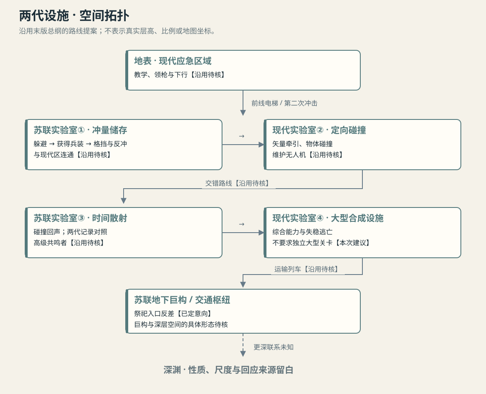
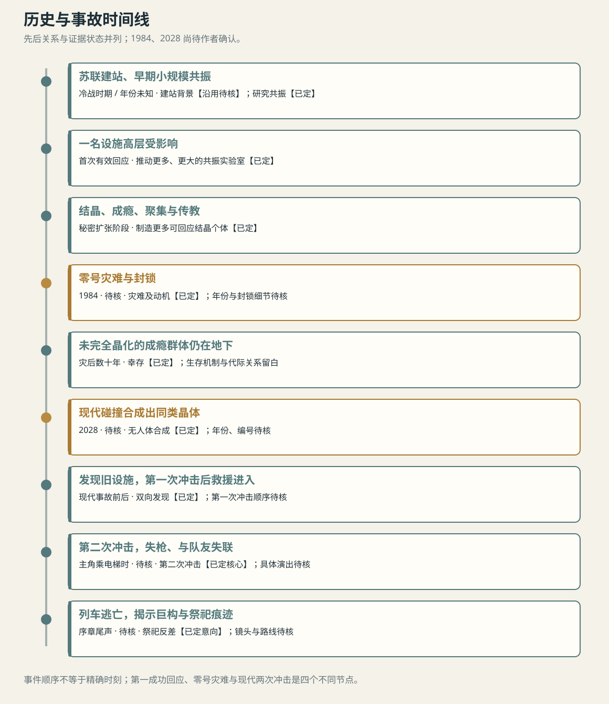
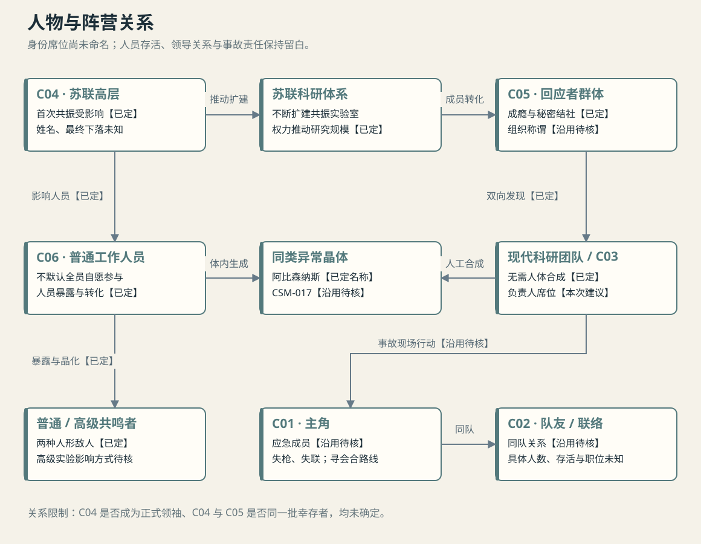

# 《零界》世界观设定档案
## NULL BOUNDARY · WORLD BIBLE · V0.9

**编纂日期：2026年10月29日 · 档案用途：团队共识、叙事、美术与关卡参考**

> 一种晶体，两条制造路径。苏联人把身体变成共振器，现代人把未知变成合成材料；两代设施终于听见了彼此。

*图像性质：本次生成的美术探索。建筑形态、灯光、晶体颜色与祭坛构成都待确认；它不代表已定的关卡尺寸或深渊真相。*

## 00 · 如何使用这份档案

本档案整理自 ChatGPT 聊天《构思巨型秘密设施》。你已在本次聊天确认，先以这条记录为主要来源。当前聊天读取工具实际返回**末尾五轮完整文字及最后一版总纲**，没有更早轮次的正文，也没有返回附件。尝试浏览器读取更早内容未成功。因此，V0.9 是对**当前可核验材料**的完整整理，不声称覆盖整条长期聊天。更早记录补齐后，可据此修订为 V1.0。

原聊天同时包含你的决定、你的备选想法、ChatGPT 的扩写和建议。为保留创作边界，全文使用四种标记：

| 标记 | 含义 | 使用规则 |
| --- | --- | --- |
| **【已定】** | 可见用户发言明确提出或选择 | 作为本版创作约束；仍可由你后续修改 |
| **【沿用待核】** | 最后一版 ChatGPT 总纲或建议中的内容，未见你逐项确认 | 暂供制作参考，不自动升级为正史 |
| **【本次建议】** | 本次为组织档案、美术或叙事新增的方案 | 可以直接替换，不影响已有核心 |
| **【留白】** | 尚无结论、刻意保留的谜团，或缺失的记录 | 不补写成事实 |

文中的“共振”“晶格”“冲量储存”“时间散射”等是**虚构世界内部的解释语言**，不是对现实可行技术的论证。涉及异常现象的机制，只提供稳定的创作规则。图示中的连线代表资料所支持的关系，不把猜测画成秘密真相。

**阅读顺序：**先读 01—05 掌握世界、历史与材料；06—08 用于人物和敌人；09—12 用于关卡、叙事与美术；13—16 用于制作范围、待定事项和溯源。

## 01 · 项目身份与创作支柱

### 1.1 项目卡

| 项目 | 当前内容 | 状态 |
| --- | --- | --- |
| 中文名 / 英文名 | 《零界》/ NULL BOUNDARY | 【沿用待核】S05-A |
| 类型 | 第一人称科幻恐怖，含动作战斗、轻物理解谜、跑酷 | 【沿用待核】S05-A |
| 团队与周期 | 4 人、14 天 Game Jam | 【已定】S05-U |
| 主题中心 | 碰撞；以共振与碰撞合成建立两代设施的联系 | 【已定】S02—S04-U |
| 体量 | 独立序章，约 30—60 分钟，优先约 30 分钟完整体验 | 【沿用待核】S05-A |
| 人形敌人 | 普通共鸣者 + 受到实验影响的高级共鸣者 | 【已定】S05-U |
| 结尾意象 | 地下巨构入口出现祭祀痕迹，形成工业设施与信仰活动的反差 | 【已定】S01-U；具体演出【沿用待核】 |
| 当前定位 | 先整理已有设定，再做细节补充与视觉参考 | 本次任务 |

### 1.2 世界的一句话

【已定核心的归纳】苏联地下设施通过深渊共振使人体产生异常结晶。共振刺激结晶并带来成瘾性的强烈体验，受影响者逐步形成秘密团体，推动更大规模实验并引发灾难。几十年后，现代研究中心在不依赖人体的条件下碰撞合成出同类晶体，促成两代设施的互相发现，最终发生第二次冲击。

### 1.3 五个创作支柱

1. **同物异名、同现象异解。**科研人员看到材料响应，回应者体验“赐予”；叙事允许两种解释并存。
2. **工业空间承载信仰。**仪器、试验台、校准标线和供能系统逐步变成仪式的一部分。
3. **成瘾驱动制度失控。**共振实验的扩张既受科研权力推动，也受肉体渴求和信仰合理化推动。
4. **尺度逐层升级。**个人身体的结晶 → 实验室装置 → 设施网络 → 远超预期的地下巨构。
5. **碰撞同时是玩法与叙事。**打击、反冲、投掷、延迟冲击均来自同一实验语言。【具体玩法沿用待核】

### 1.4 叙事基调

【沿用待核】科研悬疑、冷战工业恐怖、少量制度性黑色幽默。恐怖来自可测量的现象逐渐超出解释能力，以及实验记录中越来越不像科研的行为。

【本次建议】幽默放在告示、设备语音和流程漏洞中，避免用笑话打断第一次变异遭遇或巨构揭示。每个区域先建立“这里曾用来做什么”，再显示它怎样偏离用途。

## 02 · 地理、空间与两代设施

### 2.1 故事地点

【沿用待核，S05-A】中亚虚构地区“阿尔坎断崖”，地貌参考乌斯秋尔特高原。地表与地下的强烈反差是重要空间资源。当前没有确认具体国家、坐标、地质剖面、周边城镇或当地历史。

【本次建议】地表保持开阔、干燥、低矮的地平线；入地下后反复借竖井、桥梁、栈道显示纵深。现实地貌仅供视觉参考，不把虚构灾难归给真实设施或真实事件。

### 2.2 设施对照

| 维度 | 苏联第七综合实验站 | 现代阿尔坎联合研究中心 |
| --- | --- | --- |
| 名称与建设背景 | 【沿用待核】冷战时期地下设施 | 【沿用待核】中国主导、与当地合作建设 |
| 已定科研中心 | 共振：使地下异常反馈增强并建立接触 | 碰撞合成：制造新材料或新状态 |
| 核心制造路径 | 人体 + 深渊共振 → 阿比森纳斯结晶 | 受控碰撞 → 人工合成同类晶体 |
| 研究者最初认知 | 异常信号可被实验激发 | 合成物表现出异常响应 |
| 失控方式 | 被成瘾与信仰推动的扩大实验 | 同类晶体引出与地下系统的联系；具体事故链待定 |
| 空间语言【建议】 | 厚混凝土、重钢架、老式控制台、外露管线 | 模块化舱室、同步控制结构、自动化维护、安全隔离 |
| 当下状态 | 【沿用待核】封锁、损毁、局部仍被维护 | 【沿用待核】事故受控区域与失稳实验区并存 |

两座设施的**科研主轴与晶体路径是用户明确内容**；设施专名、现代合作背景、四实验室布局仍属于沿用总纲的工作设定。

### 2.3 空间层次示意

*这是拓扑图：说明连接关系与叙事层次，不表示准确层高、距离或工程剖面。*

- 地表：现代应急与后勤区。【沿用待核】
- 交错实验层：现代设施与苏联旧区形成可通行联系。【沿用待核】
- 更深交通层：苏联运输系统、地下交通枢纽与巨构。【沿用待核】
- 深渊：回应源方向与未知深层空间。【已定其异常联系；真实性质留白】

【本次建议】现代设施不必完全压在旧区正上方。采用“斜向接入、共享一条事故后开放的路径”，可减少现代人此前完全不知道旧设施的逻辑压力。具体选址原因仍需补齐。

## 03 · 异常材料：阿比森纳斯 / CSM-017

### 3.1 名称与分类

| 名称 | 谁在使用 | 定义与状态 |
| --- | --- | --- |
| **Abyssonance / 阿比森纳斯水晶** | 项目与苏联侧叙事 | 【已定】用户选择的组合词，表达 Abyss + Resonance |
| 阿比森纳斯晶体 | 档案编辑用语 | 【本次建议】正文统一称晶体；保留“水晶”作为原称 |
| **CSM-017** | 现代科研记录 | 【沿用待核】ChatGPT 提出的现代材料代号 |
| Collision-Synthesized Material | 现代分类释义 | 【沿用待核】碰撞合成材料 |
| CSM-017-B04 | 示例批次 | 【沿用待核】用于区分材料项目与具体批次；不证明已有 4 批成功样本 |
| 响应晶体 / R 晶 | 早期讨论旧称 | 被用户认为过于普通，归入历史别名，不作为主名称 |

CSM-017 中的“017”在总纲里指第 17 个正式归档材料项目，不是危险等级、收容编号或第 17 号人体。它借用研究机构编号的感觉，不引入其他作品的组织体系。【沿用待核】

### 3.2 两条形成路径

**苏联路径【已定】**

深渊回应实验 → 人体暴露于异常共振 → 体内形成结晶 → 后续共振刺激结晶 → 强烈愉悦与依赖 → 追求更多共振。人体既承载变化，也成为实验与信仰争夺的对象。

**现代路径【已定核心；机制沿用待核】**

受控多向碰撞 → 极端短时条件 → 固定异常晶格 → 无需人体的合成样本 → 异常响应被测得 → 顺着信号发现苏联旧设施。

【沿用待核】特殊之处主要来自亚稳态晶格与异常振动模式；现代团队通过多向冲击、精确时序与快速冷却得到类似结构。这里是虚构物理突破，无需在序章提供完整理论。

### 3.3 稳定的创作规则

| 规则 | 状态 | 对叙事和制作的作用 |
| --- | --- | --- |
| 受影响者具有一定结晶现象 | 【已定】S04-U | 身体、音效和环境反馈可复用同一视觉语言 |
| 共振会带动体内结晶，并产生强烈愉悦和成瘾体验 | 【已定】S04-U | 解释聚集、仪式与扩大实验的动机 |
| 一部分人无法承受，严重晶化或变异 | 【已定】S04-U | 支撑普通敌人来源，不新增独立敌人类别 |
| 苏联侧通常需要人体与深渊共振才能形成这种晶体 | 【已定】S04-U | 解释回应者为何重视现代合成能力 |
| 现代可在不依赖人体的条件下合成同类晶体 | 【已定】S04-U | 两代历史的关键交点 |
| 晶体可与深层异常或旧系统耦合 | 【沿用待核】S04—S05-A | 作为事故机制的工作解释 |
| “同类”精确到相同结构、相同成分还是相同响应 | 【留白】 | 不默认每种样本完全等同 |
| 人工样本是否也能改造人体、使人成瘾 | 【留白】 | 不把体内结晶的效果自动赋予所有人工样本 |
| 晶体是否有生命或自主意识 | 【留白】 | 原 ChatGPT 偏向“无生命”，尚非用户定论 |

### 3.4 外观方向

【本次建议】可探索烟灰半透明主体、淡冷色折射边缘、细密层理与不规则生长面。人体结晶以关节、衣领、脊背或耳部局部侵入的轮廓表现；人工样本以小型、受固定、可测量的试验材料表现。**颜色、位置、亮度、尺寸均待美术确认。**

【本次建议】共振时先表现机械细响、附着物抖动和小范围折光变化，再使用更显著的光效。避免让所有异常都依靠高亮发光解释。

## 04 · 世界历史与灾难时间线

*冷战时期的具体建站年未知；1984 与 2028 来自最后一版 ChatGPT 总纲，均待核。图中先后关系比具体年份更可靠。*

### 4.1 历史顺序

| 阶段 | 事件 | 状态 / 来源 |
| --- | --- | --- |
| 冷战时期，建站年未定 | 苏联地下综合实验体系建立 | 【沿用待核】S05-A |
| 早期小规模实验 | 共振实验第一次与深渊建立有效联系，一名设施高层被俘获、受到影响 | 【已定】S02-U；“俘获”的具体方式留白 |
| 秘密结社阶段 | 受影响工作人员秘密聚集、传教；结晶与强烈体验形成依赖 | 【已定】S01、S04-U |
| 扩张阶段 | 受影响高层推动更多、更大的共振实验室，意图制造更多结晶个体 | 【已定】S02、S04-U |
| **1984（待核）** | 超规模共振实验引出零号灾难，人员死亡、失智或晶化 | 灾难及推动动机【已定】；年份、分布【沿用待核】 |
| 灾后封锁期 | 旧设施被封锁；未完全晶化的成瘾团体继续存在 | 幸存群体【已定】S04-U；封锁细节【沿用待核】 |
| 数十年间 | 回应者在地下延续活动并留下仪式痕迹 | 活动延续有用户支持；供能、生存与代际关系【留白】 |
| 现代中心建立 | 新设施发展以碰撞合成为主轴的研究 | 主轴【已定】；建站时间与选址动机【留白】 |
| **2028（待核）** | 无需人体的同类晶体被合成，异常响应促成对旧设施的发现 | 路径与发现【已定】；年份、代号【沿用待核】 |
| 现代第一次冲击 | 事故后初步受控，救援与应急队得以进入 | 【沿用待核】S05-A；触发条件留白 |
| 前线电梯阶段 | 小队下行时爆发第二次冲击，主角失去枪械并与队友失联 | 第二次冲击【已定核心】；具体场景【沿用待核】 |
| 序章主体 | 主角穿越交错的实验区，逐步获得工具与能力 | 【沿用待核】S05-A |
| 序章尾声 | 列车逃亡后揭示地下巨构与祭祀痕迹 | 祭祀反差【已定意向】；列车及镜头顺序【沿用待核】 |

### 4.2 四个容易混淆的节点

- **第一次成功的深渊共振：**苏联早期接触事件，引出高层变化。
- **零号灾难：**苏联时期规模扩张的灾难，不等同于现代第一次冲击。
- **现代第一次冲击：**总纲中的现代事故节点，暂缺清晰触发与持续时间。
- **第二次冲击：**两代设施互相发现后的现代灾难；总纲把它放在主角乘电梯时。

【本次建议】文案统一用全称。正式锁定前，日志不用“第一次事故”单独指代上述任一事件。

### 4.3 当下事故因果图

已定链条：**现代合成同类晶体 → 现代发现苏联设施；地下幸存团体也发现现代设施 → 第二次冲击发生。**

【沿用待核的机制】现代激励晶体、地下旧共振装置响应、回应者干预叠加成反馈链。它能用于内部构思，但用户尚未确认每一环。谁启动了哪台设备、是否蓄意、是否存在自动响应，均不在正文锁死。

### 4.4 需要避免的历史偷渡

“回应者认为是赐予”不证明深渊存在有意志的神。“幸存了”不证明绝对免疫、长生或完全健康。“1984 到 2028”若最终采用，相隔 44 年；同一批人如何生存、是否有后代或外来补充，是待解决问题。

## 05 · 阵营、制度与信仰

### 5.1 苏联科研体系

【已定】设施内有高层人员、普通 staff 与不断扩张的共振研究。被异常影响的高层拥有推动建设的权力，使私人体验能够转变成机构决策。

【沿用待核】其他部门包括冲量储存、时间散射、逆熵、意识及其他碰撞研究。它们为世界提供纵深，Game Jam 不要求全部成为可进入关卡。

【本次建议】用实验室扩建图、被改写的审批文件和逐渐增大的设备编号展示权力变化；具体部门官职不预先编成复杂组织树。

### 5.2 回应者

**组织名【沿用待核】**“回应者”是 ChatGPT 沿用的称谓。用户明确设定了这个秘密团体的形成机制与幸存活动，但未见单独确认正式组织名。

**形成机制【已定】**真实异常体验 → 人体结晶 → 共振快感和依赖 → 秘密聚集与传教 → 推动更多暴露 → 扩大共振实验 → 灾难。

**核心动机【已定】**制造更多可以回应共振的晶体及结晶个体。较早用户还提出释放下方某物的企图；在新版本中可保留为团体的信仰目标，其真实性与优先级待定。

**当下行为【已定核心】**未完全晶体化的成瘾幸存者发现现代设施；地下存在祭祀地点。具体成员数、领导层、活动范围与是否主动袭击主角未知。

【本次建议】仪式保留实验流程的残影：调频、排列样本、校准时序、集体等待回应。成员的自我解释可以不同，但不必为此增加可战斗职业。

### 5.3 现代科研与应急体系

【已定】现代研究以碰撞合成为主轴，并无须人体就能制得同类晶体。

【沿用待核】研究中心具有自动化维护系统、安全规则与应急区域；主角属于秘密应急小队，前往地下旧区。没有可核验的人员姓名、指挥机构专名或详细任务书。

【本次建议】应急方的眼前目标保持简单：进入、确认路线、与人员会合、撤离或隔离危险。具体营救对象和必须带出的样本，不在本版捏造成已存在任务。

### 5.4 深渊

【已定】它是共振实验的异常回应来源或关联对象。

【留白】是否是生命、空间、物理现象、古老结构或其他存在；是否有意志；是否在“召唤”；回应是否发生信息交流。叙事可呈现让人产生这些解释的证据，不提供万能答案。

## 06 · 重要人物档案与关系图

原始可见资料没有给出人物姓名、年龄、性别、亲缘或恋爱关系。本版采用**身份代号**建立人物功能，不凭空制造人物史。代号可供后续编剧和美术替换；有些身份也可合并为一个人物。

*实线表示可见用户核心设定或沿用总纲关系，具体状态写在边标签；虚线为待定关系。这里展示的是人物功能和组织联系，不暗示隐藏亲缘。*

### C01 · 主角 / 应急小队成员

| 字段 | 档案 |
| --- | --- |
| 身份 | 【沿用待核】秘密应急小队成员，第一人称可操作角色 |
| 已知事件 | 【沿用待核】前线电梯遭第二次冲击，失枪、失联，进入交错实验区 |
| 近期目标 | 【沿用待核】生存、寻找会合路线、离开危险区 |
| 性格与过往 | 【留白】不设置特殊血统、失忆、既往结晶或被选中身份 |
| 视觉占位 | 【本次建议】实用应急防护装备、轮廓明确的手臂护具；姓名、面部、性别未定 |
| 制作形式 | 【本次建议】优先第一人称手臂、装备和少量倒影需求，不额外承诺全身演出 |

### C02 · 小队联络 / 队友席位

| 字段 | 档案 |
| --- | --- |
| 身份 | 【沿用待核】与主角同行或保持通信的队友；具体是否队长未定 |
| 关系 | 同队；冲击后失联不等于死亡 |
| 叙事功能 | 【本次建议】用简短通信给出行动目标、说明通信受阻和信息缺口 |
| 视觉占位 | 【本次建议】共享应急队装备语言，以小范围色带或设备区分 |
| 待定 | 人数、姓名、存活情况、重联时机、是否需要立绘 |

### C03 · 现代合成项目负责人〔可选人物槽〕

| 字段 | 档案 |
| --- | --- |
| 来源性质 | 【本次建议】总纲存在现代科研团队，尚无被确认的独立负责人角色 |
| 功能 | 作为样本报告或广播署名，让现代机构具有个人声音；可以删掉或与 C02 合并 |
| 关系 | 若保留，负责解释材料研究；不默认知情参与回应者活动 |
| 视觉占位 | 【本次建议】工作服、防护外套、识别牌；保持机构职业性 |
| 待定 | 姓名、职位、与事故关系、是否在场或仅留记录 |

### C04 · 首次受影响的苏联高层

| 字段 | 档案 |
| --- | --- |
| 身份 | 【已定】第一次深渊共振影响的设施高层 |
| 核心行动 | 【已定】随后推动越来越大的共振实验室 |
| 动机解释 | 【已定整体机制】共振体验、结晶依赖与信仰；其个人自述仍待写 |
| 关系 | 与秘密团体形成和扩张密切相关；是否正式领袖【留白】 |
| 当前状态 | 【留白】死亡、晶化、幸存或身份转化均未定 |
| 视觉占位 | 【本次建议】档案照片或老式实验防护装；局部结晶仅作探索 |

### C05 · 地下回应者维持者〔群像占位〕

| 字段 | 档案 |
| --- | --- |
| 身份 | 【已定】未完全晶化、持续成瘾的地下幸存群体 |
| 当前行动 | 【已定】发现现代设施；【沿用待核】维持部分旧装置和仪式 |
| 关系 | 与共鸣者共享异常来源，但组织性不同 |
| 是否与 C04 相同 | 【留白】不自动认定原高层活到现代 |
| 视觉占位 | 【本次建议】旧工作装、修补防护具、改作仪式用途的测量器件 |
| 制作形式 | 【本次建议】优先痕迹、背影或声音；序章无须新增第三套人形战斗 AI |

### C06 · 旧设施普通工作人员〔历史群像〕

【已定】他们是早期实验、转化、灾难和变异的参与者或受害者，不能把全体都写成自愿教徒。

【本次建议】用姓名被遮去的工牌、私人便笺、值班位置和工作工具保留其普通人的生活痕迹。任何具体家庭关系或个人小传，都需后续单独创作并标记。

### 6.7 人物关系要点

- C01 与 C02：同队关系【沿用待核】，冲击后联系状态不明。
- C04 与苏联机构：高层权力关系【已定】，推动扩大实验。
- C04 与回应者：早期转化与形成的联系【已定核心】，正式领导身份未定。
- C05 与现代团队：双向发现【已定】，交易、渗透或公开冲突未定。
- 普通共鸣者与回应者：存在共同异常来源；**“共鸣者”不等于组织成员称谓**。
- C03 的所有人际关系：均为新增人物槽的工作假设，不能从图中推导“内鬼”。

*角色图为本次美术探索：人物脸型、性别、服饰和晶体外观未定。各形象并列供参考，不表示全部都要做成 NPC 或敌人。*

## 07 · 人形异常与机械威胁

### 7.1 两种人形敌人的制作边界

【已定】只有普通共鸣者与受到实验影响的高级共鸣者两种主要人形怪物。下面是这两类的功能档案；回应者是叙事组织，不据此额外增加第三类战斗敌人。

| 维度 | 普通共鸣者 | 高级共鸣者 |
| --- | --- | --- |
| 名称 | 用户明确使用 | 用户明确类别；“复响者”为 ChatGPT 暂名 |
| 异常基础 | 人体结晶、成瘾与暴露失控 | 在基础异常上受到实验进一步影响 |
| 外观【建议】 | 保持人形，少量局部晶簇，旧工作装残留 | 共用基础人形，晶体形态或轮廓变化更明显 |
| 行为【建议】 | 被某些节律吸引；攻击前有可读的身体预兆 | 以“同一次动作的延迟复现”形成节奏差异 |
| 能力【沿用待核】 | 近身威胁、环境共振反应 | 时间散射造成延迟攻击回声 |
| 玩家学习【建议】 | 格挡时机、保持距离、利用环境 | 识别第一下之后仍有危险的时间窗 |
| 资产策略【沿用待核】 | 基础骨架、动画、AI | 复用骨架与动画，附加晶簇和延迟效果 |

【留白】普通共鸣者究竟主要来自灾难瞬间的普通工作人员，还是长期暴露的失败转化者？用户后期明确了结晶失败来源，但没有排除其他暴露人群。档案保留多种经历，不虚构精确比例。

【本次建议】高级敌人的延迟效果先用一次清晰的重复伤害或机关影响验证。数值、频率、可否格挡、是否消耗晶体，都属于玩法原型后的决定。

### 7.2 现代维护无人机

【沿用待核】原用于维护、异常能量检测与安全隔离；检测到未经授权的冲量兵装行为后尝试无效化设备。它的危险性可以来自规则执行，而非恶意人格。

【本次建议】视觉采用简洁工业机身、测量探头与可见工作状态。玩家能从灯光、姿态或音调看出扫描与处置阶段。是否列为主动敌人，需要与 14 天范围一并决定。

### 7.3 苏联重型维护机械

【沿用待核】用于搬运、固定与维护大型试验设备，力量巨大。

【本次建议】作为轨道移动障碍、夹具危险或固定演出即可。可做一段重复动作，不承诺完整追逐、寻路或 Boss 战。

### 7.4 严重晶化的人员

【已定】有些人身体无法承受而严重晶体化。

【本次建议】先做静态场景遗留、局部模型或普通敌人外观变体，**不把它扩展为第三种完整怪物**。遗留位置应与实验流程相关，而非随机堆满走廊。

## 08 · 科研体系、工具与异常边界

### 8.1 两种研究观念

**苏联：共振【已定】。**寻找并放大地下回应，重复接触，扩大装置与暴露规模。

**现代：碰撞合成【已定】。**精确安排相互作用，制造新的材料与状态。旧讨论中的“相干相消”不能继续占据现代研究主轴。

【沿用待核】现代研究可由极端态碰撞提供基础，动量路由负责控制，逆散射重构负责分析；相消、禁带与碰撞计算只作为安全技术或支线背景。

### 8.2 能力与设备表

| 系统 | 世界内用途 | 玩家用途 | 状态 |
| --- | --- | --- | --- |
| 冲量储存近战兵装 | 收集、压缩与释放碰撞影响 | 格挡、蓄积、近战释放 | 【沿用待核】S05-A |
| 反冲 | 装置释放后的反作用表现 | 跳跃、空中调整与跑酷 | 【沿用待核】 |
| 矢量牵引装置 | 便携式定向碰撞控制工具 | 牵引、搬运、投掷特定物体 | 【沿用待核】S03、S05-A |
| 碰撞回声 | 时间散射研究的局部异常 | 冲击在短暂延迟后再次生效 | 【沿用待核】 |
| 大型多向合成大厅 | 同步多向冲击的核心实验设施 | 事故、综合逃亡与规模展示 | 【沿用待核】 |
| 逆熵、意识、事件合成 | 更广科研空间 | 当前序章无需独立机制 | 早期 ChatGPT 扩展，未被用户选择 |

### 8.3 为原型设定的限制〔本次建议〕

- 牵引只作用于明确标记的一组物体，避免“所有东西都能搬”的预期。
- 碰撞回声只作用于定义好的对象或攻击，不默认复制生命、复活人物或穿越历史。
- 储存能力使用容量、释放窗口或清晰的过载反馈，避免无限储能。
- 玩家跑酷能力、敌人回声与机关表现采用一致的预告语言。
- 重要机关的可用状态至少有视觉或声音反馈，不依赖长段文字。
- 异常装置只解释当前可玩规则，不因一个新能力重新解释全部宇宙。

这些是制作建议，不覆盖原剧情决定。具体参数须在可玩原型中验证。

## 09 · 序章流程与信息释放

四实验室路线来自最后总纲，尚未由你逐项确认。这里把它组织成可讨论的流程，不把四间实验室误认为四个大型独立关卡。

| 段落 | 玩家行动 | 能力 / 威胁 | 叙事信息 | 建议环境证据 |
| --- | --- | --- | --- | --- |
| 地表应急区 | 学习基础操作、领枪、进入电梯 | 现代秩序与应急流程 | 事故曾短暂受控 | 临时封锁、被重置的警告灯 |
| 电梯事故 | 遭第二次冲击、失联失枪 | 空间断裂、紧迫撤离 | 事态再次升级 | 同时出现的新旧频段、被中断的通信 |
| 苏联实验室①：冲量储存 | 躲避后获得兵装 | 普通共鸣者、格挡与反冲 | 旧区存在人体异常与不同技术 | 旧控制台、晶化工作位置 |
| 现代实验室②：定向碰撞 | 牵引、投掷、开启路径 | 定向碰撞、可选无人机 | 现代合成物有异常响应 | 样本固定架、合成记录 |
| 苏联实验室③：时间散射 | 学习碰撞回声 | 高级共鸣者、延迟机关 | 旧实验响应与现代记录相似 | 旧波形纸、加写的仪式标记 |
| 现代实验室④：大型合成设施 | 综合运用能力穿越失稳区 | 崩塌、反冲与牵引组合 | 两套系统的联系可见 | 同步动作的旧新设备、断裂隔离结构 |
| 列车与巨构 | 逃离、静观尺度揭示 | 紧张后释放 | 设施比预期大；地下活动尚未结束 | 小型祭祀台、仍被维护的线缆、远处巨构 |

*前四列以【沿用待核】为主；末列为【本次建议】。祭祀反差源于用户，具体安排仍可调整。*

### 9.1 场景尺度与首次揭示

【本次建议】前期只给出几段不可见全貌的竖井和远处设备，避免开场就展示全世界。结尾先用车体或人形标尺让玩家理解近景，再让灯光揭开远景。

祭坛可以放在巨构入口或前景，不必让玩家先经过一座大型宗教关卡。它的重要性在于：这种空间里仍有人以特定方式生活和工作。

### 9.2 玩家应该知道多少

| 时点 | 玩家可以确认 | 玩家仍不能确认 |
| --- | --- | --- |
| 开场 | 这里是发生事故的研究设施；自己的眼前任务 | 旧设施全部历史、地下团体的目标 |
| 得到兵装后 | 旧区技术与身体异常有关 | 结晶是否是一种“恩赐” |
| 现代样本区后 | 人工材料存在异常响应 | 人工晶体是否能改变人 |
| 苏联第三实验室后 | 两代记录具有对应特征 | 是否存在神、预言或因果闭环 |
| 结尾 | 地下空间远超预期，有祭祀或维护痕迹 | 谁仍活着、谁制造第二次冲击、深渊是什么 |

【本次建议】“知道对应关系”不等于“看懂全部机制”。把核心联系讲清楚，深层解释继续留白。

## 10 · 环境叙事、档案与声音样本

本节所有具体文案为**本次新写的示例**，可剪裁后放进游戏；它们不是从缺失记录里恢复出来的定稿。日期、签名、编号不用来反推正史。

### E01 · 现代样本记录〔短文本〕

> 材料编号：CSM-017〔暂用〕  
> 响应测试：重复出现。  
> 当前激励程序已停止，背景响应仍未消失。  
> 处理意见：保持隔离，暂缓扩大样本规模。

【用途】建立“合成成功”和“解释失败”同时发生的感觉。其具体异常持续特征为建议，需要你决定是否采用。

### E02 · 苏联试验纸背面的批注

原 ChatGPT 提出的句子是：**“祂又回答了。”**【沿用待核，S05-A】

【本次建议】正面是实验记录，背面只有这行手写批注。无需额外给出神的名字或图像。波形相似可以通过环境对照展示，文字只是补充。

### E03 · 共振停机后的私人便笺

> 停机之后，大家都说终于安静了。  
> 我只想让它再响一次。

【用途】用个人渴求传达成瘾，避免说明书式讲解。作者仅为未命名工作人员，不默认就是 C04。

### E04 · 扩建审批中的异常

【本次建议】同一套建筑图上可见几轮扩建，试验腔越来越大，安全隔离区却被反复涂改。无须读懂整页文字，也能看出规模增长。

### E05 · 现代自动安全语音

> 检测到未授权的冲量释放。请将实验兵装置于隔离支架。

【用途】用于无人机或安全设备的行动预告。是否真的执行扫描与隔离，应与玩法一致。

### E06 · 巨构入口的仪式装置

【本次建议】旧操作台上排列少量晶体、校准工具与被改作仪式标记的测量纸。某处连接仍通向设备。痕迹是否新鲜只做到“可疑”，不凭一盏灯证明 44 年有人类持续存活。

### 10.7 声音设计语言〔本次建议〕

- 苏联系统：继电器、低沉机械振动、缓慢启动与不稳定的老广播。
- 现代系统：同步脉冲、短促确认音、冷静安全播报。
- 人体结晶：微小摩擦与颤音，环境共振时有一致的响应。
- 高级共鸣者：第一下与回声之间保持可学习的空隙。
- 结尾：先让列车与近景声占据听觉，再用空间回响表达巨大体积。

## 11 · 美术设定与视觉占位规范

### 11.1 色彩与材质〔全部为本次探索〕

| 层次 | 基础材料 | 色彩方向 | 视觉作用 |
| --- | --- | --- | --- |
| 苏联设施 | 粗混凝土、铆接钢、旧漆、玻璃仪表 | 暗灰、旧青绿、少量琥珀光 | 厚重、陈旧、依然具有工程秩序 |
| 现代设施 | 涂装金属、模块化护板、防护窗 | 灰白、低饱和冷色指示光 | 精密控制与自动化 |
| 仪式痕迹 | 复用科研设备、手绘标线、修补材料 | 沿用场景原色，增加局部人工痕迹 | 展示日常仪器的用途被改变 |
| 阿比森纳斯 | 不规则层理、半透明截面 | 烟灰与淡冷色边缘候选 | 既可被测量，又令人不安 |
| 深渊 | 无法确认的深度、受限可见范围 | 减少颜色与可读形状 | 留下未被解释的空间 |

### 11.2 角色占位制作规范

本版提供一张角色探索图与一套身份占位卡。立绘中的衣着仅用于讨论，不设定人物国籍、性别或面部正史。

- **P01 主角：**可用简化人形与应急装备色块；第一人称优先检查手部轮廓。
- **P02 队友：**复用 P01，以设备或小范围配色区分。
- **P03 现代研究员：**工作服与防护外层；对应 C03 可选席位。
- **P04 苏联高层：**档案照轮廓或防护服；是否显露结晶未知。
- **P05 回应者：**人形、防护装备与校准器件组合；保持组织性。
- **P06 普通 / 高级共鸣者：**同源轮廓做两个状态，突出攻击预告与局部晶体差别。

### 11.3 图像的使用边界

环境三联图分别研究苏联共振大厅、现代碰撞合成室、苏联地下交通枢纽与祭台。角色图研究应急人员、科学人员、回应者和两种共鸣者。图像新增的任何道具、脸、服装、颜色、晶体尺寸或机房结构，都属于美术试探。

关系图、时间线、空间图采用可编辑 SVG；图中只表达本档案的结构。不要从场景概念画推导真实层高、地图尺寸、建筑年代或额外 NPC 数量。

## 12 · 术语表与命名纪律

| 术语 | 当前定义 | 使用提醒 |
| --- | --- | --- |
| 零界 / NULL BOUNDARY | 暂用项目名 | 来自末版总纲，待核 |
| 阿比森纳斯 / Abyssonance | 核心异常晶体名 | 用户明确选择 |
| CSM-017 | 暂用现代合成材料编号 | ChatGPT 提案，待确认 |
| 深渊回应 | 共振激励后出现的异常反馈 | “回应”不直接证明意识 |
| 回应者 | 秘密团体的暂用正式称谓 | 与“共鸣者”分开 |
| 共鸣者 | 两种人形怪物的基础称谓 | 不代表所有成员都是教徒 |
| 复响者 | 高级共鸣者暂名 | 时间散射关联也待核 |
| 零号灾难 | 苏联扩大共振实验后的灾难 | 不与现代事故混用 |
| 第一次冲击 | 总纲中的现代初次事故 | 具体触发留白 |
| 第二次冲击 | 双向发现后的现代灾难 | 人为与自动因素比例留白 |
| 冲量储存 | 近战兵装所用虚构实验技术 | 玩法沿用待核 |
| 矢量牵引 | 定向碰撞控制装置的便携应用 | 不能自动等于全能重力控制 |
| 碰撞回声 | 受冲击结果的短延迟再次生效 | 不自动扩展为历史时间旅行 |
| 阿尔坎断崖 | 暂用虚构地名 | 未定具体国家与坐标 |
| 第七综合实验站 | 暂用苏联设施名 | 不对应真实历史设施 |
| 阿尔坎联合研究中心 | 暂用现代设施名 | 建设背景待核 |

【本次建议】组内可以使用简码 NB、SOV、MOD，但玩家文案优先用稳定的少量名字。名称改动集中更新本表、图示和引用，避免同一人或物出现多个“正式名”。

## 13 · 14 天版本与后续空间

本节是从已有范围推导的**制作建议**，不是一份已经排期完成的开发承诺。

| 优先层级 | 内容 | 处理方式 |
| --- | --- | --- |
| 核心 | 两代设施、同类晶体、普通与高级共鸣者 | 保留用户明确的世界观与数量边界 |
| 核心体验建议 | 一个完整起承转合、一种可用主要能力、清楚的失败和结束 | 先做完整可玩路径，再扩展组合 |
| 总纲目标 | 四实验室、近战储冲、牵引、回声、反冲 | 作为目标清单，逐项验证成本 |
| 可压缩 | 地表教学、队友演出、主动无人机、巨型机械 | 教学嵌入路线；机械可降为场景装置 |
| 视觉重点 | 两代设施辨识、两种人形状态、巨构结尾 | 复用结构，集中制作关键镜头 |
| 未来保留 | 逆熵、意识、因果、事件合成、更多深层设施 | 保留在档案，不变成当前关卡任务 |
| 暂不新增 | 第三种人形战斗敌人、多阵营战斗系统、复杂 NPC 交互 | 遵循用户最后的体量约束 |

【本次建议】若完整四实验室超时，可以保留四个功能段落，缩小空间；若某能力来不及实现，在叙事上让它作为背景设备出现。不要为了档案完整度让每个研究部门都成为独立系统。

### 13.1 最小资产参考清单〔建议〕

- 一套可复用苏联结构件、一套现代实验区结构件。
- 一个人形基础与两种异常状态；不额外承诺完整回应者战斗资产。
- 一套晶体材质和少量晶簇，用尺寸与布置区分人体和样本。
- 一件核心兵装；其他能力可先用同一设备模式区分。
- 少量关键叙事物件：旧波形纸、现代样本架、仪式化操作台。
- 巨构远景与尺度参照；列车可作为固定路线演出。

## 14 · 尚未定案的问题与修订顺序

### 14.1 优先确认的五件事

| 优先级 | 问题 | 当前推荐处理 |
| --- | --- | --- |
| 1 | 项目名、地名、设施名，以及 1984 / 2028 是否采用 | 先整体确认总纲专名与年代，避免图表反复改动 |
| 2 | 现代代号是否使用 CSM-017 | 保留可替换编号，不围绕数字编阴谋 |
| 3 | 高级共鸣者是否确认为时间散射型，“复响者”是否正式名 | 先用一次明确的延迟冲击验证战斗节奏 |
| 4 | 第一次冲击、旧区发现、救援进入的精确先后与原因 | 补一张事故小时级流程；当前不编具体时刻 |
| 5 | 回应者从旧灾难延续到现代的方式 | 可保留谜团，但内部至少确定需要哪些线索 |

### 14.2 长期保留的谜团

- 深渊是什么？反馈是否出于意志？
- 第一名被影响高层经历了什么，后来去了哪里？
- 晶体究竟是媒介、结果还是更大系统的一部分？
- 回应者为何把现代合成物视为重要对象？是否已接触或取得样本？
- 第二次冲击是谁推动，哪些部分是意外？
- 人工晶体是否会产生同样的生理作用？
- 巨构下方还有什么？更古老结构是否存在？
- 1984 与现代事故是否有更深联系？因果闭环只是旧提案，未成正史。

### 14.3 一致性风险与保留办法

| 风险 | 当前处理 |
| --- | --- |
| 旧设定说全员死亡，新设定又有幸存组织 | 以用户后期“未完全晶化的成瘾幸存者”为准；死亡比例留白 |
| 组织成员与怪物混成同一称谓 | 团体暂称回应者，敌人称共鸣者 |
| 成瘾被写成绝对精神控制 | 保留依赖与信仰机制，不声称所有成员完全无自主性 |
| 原地维持数十年却没有供能或生存解释 | 列为关键待定，环境只展示局部运行 |
| 现代明知旧站仍建在上面 | 用户给出通过晶体发现旧站；选址与此前知情程度另行决定 |
| 晶体合成被写成成熟量产 | 用户确认“制得”，没有确认商业化、产量或批次稳定性 |
| 工具越来越强导致所有门都失去意义 | 通过可作用对象、容量与触发条件保持一致规则 |
| 结尾出现祭坛就自动等于当前有人类活动 | 保留痕迹年代与维护者身份的不确定性 |

## 15 · 版本取舍与来源索引

### 15.1 来源编号

原始返回文字按从旧到新保存在本地来源文件。U 代表用户；A 代表 ChatGPT。下表中的摘要由本次编纂者归纳。

| 编号 | 用户讨论重点 | ChatGPT 内容在本版的地位 |
| --- | --- | --- |
| S01 | 回应实验使 staff 逐渐结社；讨论两种灾后路线；希望巨构入口有祭台反差 | 组织称谓、三层生态与更多敌人均属提案 |
| S02 | 苏联主轴改为共振；高层首次受影响；实验室逐渐扩大；寻找现代主轴 | 六种现代研究方案为备选，不能全部视为选中 |
| S03 | 选择现代主轴为碰撞合成，询问融合方向 | 极端态碰撞、动量路由等具体分工属建议 |
| S04 | 结晶带来共振快感和成瘾；制造更多结晶引发灾难；现代无人体合成同类晶体；双向发现与第二次冲击 | 科学机制、代号、附加敌人树均待选择 |
| S05 | 选择 Abyssonance；需要现代分类代号；明确 4 人 14 天与两种人形怪物；希望 Codex 整理设定集 | 最后总纲提供专名、年份、四实验室路线与暂名，供沿用核对 |

### 15.2 采用优先级

用户较晚明确决定 → 用户较早且未被改写的内容 → ChatGPT 最后总纲的工作提案 → 较早备选 → 本次新增建议。若前后冲突，保留冲突记录，不用流畅文风掩盖。

### 15.3 已降级或替换的旧提案

| 旧内容 | 当前处理 | 原因 |
| --- | --- | --- |
| 响应晶体 / R 晶作为主名称 | 历史别名 | 用户明确希望更有辨识度的组合词，选择 Abyssonance |
| 现代主轴为相干相消 | 不作为现代主轴 | 用户后来选择碰撞合成 |
| 多种二次变异敌人、再生体、叠相体等 | 未来备选库 | 用户最后明确只要两种主要人形怪物 |
| 团体全灭、地下仅剩怪物 | 非当前主要路线 | 用户后期写出仍存活的未完全晶化成瘾群体 |
| 教徒完全免疫灾难 | 不当作已定事实 | 后期机制更接近不同程度晶化与幸存，免疫条件未定 |
| 碰撞计算、事件合成、古老合成实验真相 | 留作远期提案 | 均非用户最后确认的当前剧情 |
| 现代晶体可以成熟批量生产 | 不采用为事实 | 用户只确认无需人体合成，没有确认工业量产 |

### 15.4 可核验来源

- 原聊天：[《构思巨型秘密设施》](https://chatgpt.com/c/6ae1f68e-7ff0-83e8-b91d-c4e127a8631e)。
- 本地文字：[聊天记录—可访问五轮](sources/聊天记录-可访问五轮.md)。
- 本次美术提示词与图像说明：[图像生成与设计说明](图像生成与设计说明.md)。
- 图表源文件：images/ 下的 SVG，以及“图表源码.mmd”。
- 当前档案没有引入新的现实历史考据或第三方世界观素材。

## 16 · 后续交接与档案维护

### 16.1 给编剧

先确认专名、年份、事故先后和角色席位。把角色代号替换为真正需要的人物，确定哪些角色只通过记录出现。不要为填满人物卡而新增亲缘、背叛或命定身份。

### 16.2 给美术

先选两代设施与晶体的基础语言，再选择一套普通 / 高级共鸣者差异。概念图仅用于对照方向；图中其他形象可继续占位，视觉选择不会自动变成剧情事实。

### 16.3 给关卡与程序

以“一个区域教一个主要交互”为工作目标。参考流程表安排线索；所有能力边界与高级敌人回声需要在原型中确认。世界深度可以来自远景和记录，无须对应全部可玩系统。

### 16.4 更新规则

每次实质决定应记录：改了什么、为何改变、取代哪条旧设定、来源是哪轮讨论。把【沿用待核】改为【已定】之前，先留下用户确认依据；本次生成图不作为原设定证据。

**V0.9 交付范围：**世界概览、两代设施、晶体机制、历史和事故时间线、阵营、身份人物卡、人物关系图、两种人形敌人、机械威胁、工具规则、序章流程、环境叙事、美术参考、术语、制作边界、待定问题与来源索引。更早聊天正文与附件尚未取回，是升级 V1.0 的资料缺口。

